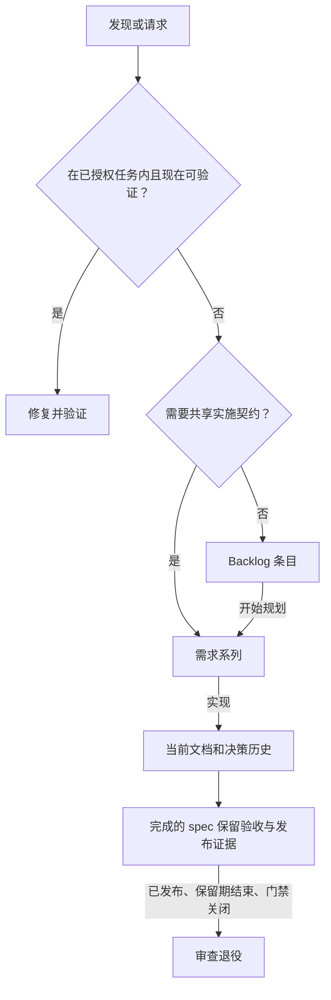

# 在仓库中落地记录生命周期

[English](en/08-record-lifecycle.md) | **简体中文**

一个有用的仓库，应让下一位维护者找到当前行为、未完成工作，以及允许旧记录退出的证据。先建立四类记录和人工复查，再让自动化执行符合本项目发布方式的规则。

本文把[仓库运行记忆](06-repository-as-operational-memory.md)转化为日常工作流。实践来自一个 POS 应用和配套员工应用：记录模型相同，但发布版本格式、源码路径、兼容门禁不同。可复用的是生命周期，不能直接照搬部署假设。这里提供[可复制的政策模板](../templates/record-lifecycle-policy.md)，不安装巡检脚本。

## 从一个功能开始

1. 选一个需要由原作者之外的人维护的功能，用一页文档描述当前行为。
2. 可独立处理但暂缓的问题进入 backlog；需要协调的未来工作进入需求契约。
3. 重要变化的原因进入简短变更记录或已有决策记录。好的 commit/PR 说明直接链接，不重复写。
4. 在政策模板中写明维护者、发布证据、保留规则和人工门禁。未确定前保持人工删除。
5. 请另一位维护者找到当前行为、一个延后问题及其关闭证据，修正他找不到的入口。

不必为了匹配示例目录而搬动已有文档。先把现有位置映射到四种职责。

## 每个事实只有一个归属

| 记录 | 回答的问题 | 更新方式 | 退出条件 |
| --- | --- | --- | --- |
| `docs/<feature>/README.md` | 现在如何工作？ | 行为变化时重写，包含用户会遇到的限制。 | 功能消失，且引用已修复。 |
| `docs/change_log/YYYY-MM-slug.md` | 为什么做这次改变？ | 记录取舍、落地证据和未完成发布工作。 | 保留期后复查；未完成 fallout 和仍有价值的理由继续保留。 |
| `BACKLOG.md` | 已知但有意延后的是什么？ | 按领域组织，附源码锚点、延后原因和具体修法。 | 验证后打勾，发布后清理；失效项注明原因后删除。 |
| `requirement_doc/<series>/` | 协调工作的实施契约是什么？ | 写范围、验收、阶段顺序和门禁，区分提议与批准。 | 实现后移入 `done/`；发布、观察期结束且门禁关闭后退役。 |

长期架构决策继续放在已有 ADR 系统中。短期变更记录与 ADR 寿命不同，不能用统一的 60 天规则删除仍需要的决策理由。如果理由只存在于短期记录里，先保留它，或转入长期决策记录。

示例仓库为完成的需求和 change log 选择了 60 天，这是本地政策，不是行业标准。两者起算点也不同：需求从首次生产发布开始，change log 从落地开始。已勾 backlog 在关闭提交发布后即可清理，不额外等 60 天。

## 写更多记录之前先路由



“范围内”指同一功能、同类工作，不需要新的产品或跨系统决定，且能在本任务中验证。同处一个源码文件不够。仓库常设规则可以在这些边界内授权顺手修复；发现问题本身不授权无关工作。

提升需求时转移证据和验收标准，删除原 backlog 条目，由需求索引负责导航。不要维护两份可独立修改的任务正文。

## 跟随一次变化

假设一个列表在响应格式错误时显示空状态。以下是说明流程的虚构示例，路径和版本都是占位值。

**发现并延后。** 如果不属于当前任务，记录一个短条目：

```markdown
## Orders

- [ ] **格式错误的响应看起来像空列表** — `src/orders/load.ts:42`
  捕获解析错误后返回空数组。**Why deferred:** 当前改动只调整排序。
  **Fix:** 展示可恢复错误；分别验证格式错误响应与真正成功的空响应。
```

**实现并验证。** 拾取时修改行为，验证两种响应，重写功能文档。只有条目描述的故障被防止后才打勾。如果还需要服务器契约协同变更，先提升为需求。

**记录原因。** 简短说明空状态为什么误导、实现在哪里、还有什么发布依赖。没有 fallout 就省略该段；简单解析器可能把写着“无”的 `Fallout` 段也当成未关闭门禁。

**发布并观察。** 生产 tag（如 `v1.4.0`）包含关闭提交后，巡检可以提议清理已勾项。如果还完成了需求阶段，发布栏填写 `v1.4.0`，设备验证继续保持开放：

```markdown
| Phase | First production release | Status |
| --- | --- | --- |
| [Phase 1](done/phase-1-errors.md) | v1.4.0 | Implemented; device verification pending |
```

**退役。** 负责人记录设备验证结果后，才把状态改为已验证完成。保留期与引用检查通过后，spec 可以退出，Git 留下历史验收记录。发布 tag 本身不会关闭设备门禁。

## 写清日常动作

| 时机 | 人或 Agent 做什么 | 机制 |
| --- | --- | --- |
| 会话开始 | 读取与任务相关的生命周期发现。 | 只读报告或会话 hook。 |
| 编辑前 | 按路径检索开放问题，拾取已授权工作。 | Backlog 查询。 |
| 修改中 | 更新行为文档、重要理由和临时代码标记。 | Review 与相关 skill。 |
| 提交前 | 审查 diff、验证行为、检查链接和索引、点名变更记录。 | 本地检查与 CI。 |
| 发布后 | 附发布证据；设备和依赖门禁待验证后关闭。 | 发布元数据与明确负责人。 |
| 定期维护 | 审查删除建议和未决事项。 | 先报告，再维护 PR。 |

实现提供这些命令时，它们的职责如下：

```sh
node scripts/doc-lifecycle.mjs          # 只报告
./backlog.sh src/orders                 # 当前领域的开放工作
./backlog.sh --changed                  # 当前 diff 相关工作
node scripts/check-docs.mjs             # 确定性的文档检查
node --test scripts/doc-lifecycle.test.mjs
```

这些是接口示例，本指南仓库没有这些命令。对于不执行 hook 的工具，在 `AGENTS.md` 或对应助手入口中写明替代步骤。复制 skill 不会自动安装会话 hook、强制检查，也不能保证判断型 review 一定发生。只注入上下文的 hook 应称为提醒；CI 只保证它实际检查的规则。

可选 commit trailer 将提交与记录连接起来：

```text
Docs: docs/orders/README.md
Change-log: docs/change_log/YYYY-MM-order-errors.md
Closes-backlog: 格式错误的响应看起来像空列表
```

## 配置各仓库不同的部分

| 设置 | POS 应用示例 | 员工应用示例 | 你需要决定 |
| --- | --- | --- | --- |
| 源码扫描 | `mobile/src/` | `src/` 加相关原生插件 | 临时代码可能出现的全部路径。 |
| 生产 tag | `vX.Y.Z.W` | `vX.Y.Z` | 精确允许格式，排除预览和预发布。 |
| 敏感契约变更 | 本地 schema、migration、云端注册 | POS 提供的 API payload | 哪些修改必须更新契约文档。 |
| 兼容证据 | 活跃设备 fleet 和数据库修复覆盖 | 员工端 rollout 与独立发布的 POS 版本 | 谁从什么设备清单或遥测作出确认。 |
| 保留期 | 本地选择 60 天 | 本地选择 60 天 | 符合发布、支持和审计需要的时长与起算点。 |

不使用 tag 的系统，需要先定义等效的不可变部署证据，再自动清理依赖发布状态的记录。不能默默替换成“已合入 main”。还要定义可信的发布时间：tag 指向的 commit 日期可能早于实际部署。

检查器与报告共用一份标记语法，例如：

```ts
// COMPAT(gate >= 1.4.0): 活跃客户端升级前继续读取旧配对格式。
// HOTFIX(until 2026-12-01): 临时重试上限；正式修复在 backlog。
// WORKAROUND(when upstream fixes reconnect): 重新打开连接。
// DEPRECATED(tag >= v1.5.0): 过渡期间保留旧字段。
```

独立部署的依赖可能需要单独条件，例如 `pos >= <version>`。每个标记都有点名源码文件的开放删除项。日期或 tag 到期表示“审查这次代码修改”；文档巡检不删除应用代码。Fleet 和外部事件门禁需要人工证据。

数据库修复 migration 不能仅凭 fleet 版本删除。必须验证成功应用、全新安装，以及恢复入口仍接受的每种备份形状。只有剩余代码能修复旧备份，或经过测试的恢复守卫会拒绝它们，修复逻辑才能退出。Seed 继续承担新装初始化。

## 分三步引入自动化

**一，只报告。** 使用完整 Git 历史和 tags，区分可退役、等待发布、等待人工、格式错误或未配对。成功退出仅表示报告完成，不表示门禁全部关闭。

**二，提出可审查 diff。** 只在临时 checkout 或干净维护分支运行应用模式。检查删除项，验证剩余链接和索引，再开 PR。证据缺失或无法解析时保留并报告，不猜测。首轮结果提交后再次执行，不应产生新的变化。

**三，定时执行同一流程。** 应用前跑回归测试，应用后跑文档检查。拉取完整历史，限制写入维护分支，避免巡检并发；没有 PR 时也发布报告。确认仓库或组织允许自动化账户创建 PR。一次无变更的绿色运行不能证明开 PR 可用，要用真实维护 diff 验证。不具备该能力时，保持定期报告，由维护者提交审查后的 diff。

报告应该回答“接下来做什么”：

| 结果 | 下一步 |
| --- | --- |
| 已关闭、未发布 | 保留，等待生产证据。 |
| 保留期结束、门禁开放 | 负责人验证；不要为了消除报告而改状态。 |
| 阶段行或状态列缺失 | 修复索引，保留 spec。 |
| 仍被引用 | 更新引用方或保留记录。 |
| 标记未配对 | 恢复删除项，或确认标记已失效；先检查扫描范围。 |
| 旧记录有 fallout | 解决依赖，或转移真正独立的工作后再退役。 |
| 创建 PR 被拒绝 | 修复仓库设置或走人工 PR，不绕过 review。 |

## 启用删除前证明规则可靠

用临时 Git 仓库构造可控提交与 tags。验收案例比复制实现更重要：

- 预发布、预览或无关 tag 不能清理已完成项；包含关闭提交的合规生产 tag 可以。
- Spec 移入 `done/` 时才开始寻找发布证据，不追溯到早期创建。纠正误填发布栏时不能覆盖状态栏。
- 缺行、缺失或空白状态列、未关闭门禁、所属索引之外的引用，都应保留 spec。
- 清理 backlog 时保留开放项、正文和导航指针。
- Change log 清理保留未解决 fallout；支持的链接改写指向真实落地证据，不支持的引用阻止删除。
- 明天的日期今天不能到期；`tag >=` 接受当前分支上更晚的合规版本，忽略其他分支和预发布。
- 报告模式不修改记录；应用两次结果幂等。任何模式都不删除应用代码或推断 fleet rollout。
- 测试覆盖采用方的实际源码根目录、插件、链接形式和表格布局。

检查时，POS 实现已对其中多种情形提供回归覆盖；较旧的员工端实现说明，不能只复制脚本而不带测试。改造任一方案时，都应将脚本、政策、测试和 CI 触发范围放在同一次审查里。

## 保持流程轻量

纯样式改动不需要新需求或变更记录。每周报告应该引导一个决定，而不是生成第二份 backlog。衡量寻找正确上下文的时间、误报、未关闭门禁的年龄和错误退役，不衡量文档数量。不能改变决定、只制造噪音的规则应简化。

下一步：填写[记录生命周期政策](../templates/record-lifecycle-policy.md)，再用[采用路线图](07-adoption-roadmap.md)评估试点。
