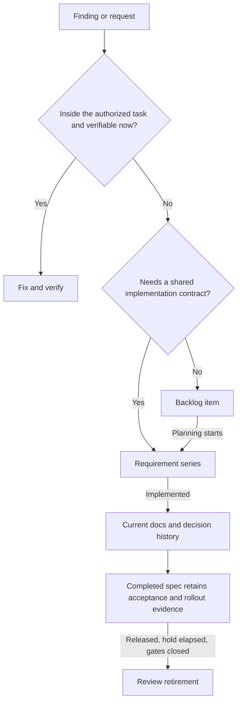

# Adopt a Repository Record Lifecycle

**English** | [简体中文](../08-record-lifecycle.md)

A useful repository tells the next person what works today, what remains open, and what evidence permits old records to leave. Start with four record types and a manual review. Add automation only after the rules match your release process.

This playbook turns [repository operational memory](06-repository-as-operational-memory.md) into a daily workflow. It draws on a POS application and a companion staff app: they share the record model, but have different release formats, source paths, and compatibility gates. The transferable part is the lifecycle, not their deployment assumptions. This guide supplies a [copyable policy template](../../templates/en/record-lifecycle-policy.md); it does not install a sweep script.

## Start with one feature

1. Pick a feature someone other than its author needs to maintain. Write its current behavior in one page.
2. Move independently actionable, deferred problems into a backlog. Keep coordinated future work in a requirement contract.
3. Preserve the reasons behind consequential changes in a short change record or an existing decision record. Link to good commit/PR explanations instead of repeating them.
4. Name the maintainer, release evidence, retention rule, and manual gates in the policy template. Keep deletion manual until these are settled.
5. Ask another person to find the current behavior, one deferred issue, and the evidence needed to close it. Fix the navigation they cannot follow.

No existing documents need to move just to match these directory names. Map your current locations to the four roles first.

## Give each fact one home

| Record | Question | Update rule | Retirement rule |
| --- | --- | --- | --- |
| `docs/<feature>/README.md` | How does it work now? | Rewrite when behavior changes; include limitations users can encounter. | Remove when the feature disappears, after repairing references. |
| `docs/change_log/YYYY-MM-slug.md` | Why did this change happen? | Record the tradeoff, landing evidence, and unresolved rollout work. | Review after the chosen retention window; retain unresolved fallout and rationale that still matters. |
| `BACKLOG.md` | What is known and deliberately deferred? | Group by area; include a source anchor, why deferred, and what a fix takes. | Tick after verification; prune after release evidence. Remove invalid items with a reason. |
| `requirement_doc/<series>/` | What contract governs coordinated work? | Record scope, acceptance, phase ordering, and gates; identify proposed versus approved work. | Move implemented phases to `done/`; retire only after release, the observation window, and closed gates. |

Keep durable architectural decisions in your existing ADR system. A short-lived change log and an ADR have different lifetimes; a blanket 60-day deletion rule must not erase a decision people still need. If a required rationale only exists in a short-lived entry, retain it or move it to the durable decision record first.

The example repositories use 60 days for completed requirements and change logs. That is a local policy choice, not an industry standard. The two clocks also differ: completed requirements start at their first production release; change logs start at landing. A checked backlog item can leave after its closing commit ships, without the extra 60-day hold.

## Route work before writing more records



“In scope” means the same feature and kind of work, no new product or cross-system decision, and a fix you can verify in this task. Sharing a source file is insufficient. A standing repository rule can authorize adjacent fixes within these boundaries; discovery alone does not authorize unrelated work.

Promotion transfers the evidence and acceptance criteria to the requirement and removes the original backlog item. The requirement index becomes the navigation entry. Do not maintain two independently editable task descriptions.

## Walk through one change

Suppose a list silently displays an empty state when a response is malformed. This is an illustrative example; the paths and version below are placeholders.

**Discover and defer.** If the fix is outside today's task, write a compact item:

```markdown
## Orders

- [ ] **Malformed responses look like an empty list** — `src/orders/load.ts:42`
  catches parse errors and returns an empty array. **Why deferred:** today's
  change only adjusts sorting. **Fix:** show a recoverable error; verify a
  malformed response and a genuinely empty successful response separately.
```

**Implement and verify.** When picked up, make the behavior change and test both cases. Rewrite the current feature page. Tick the item only once its stated failure is prevented. If the same change requires a coordinated server contract, promote it to a requirement first.

**Record the why.** A short change entry says why the empty state was misleading, links the implementation, and names any unresolved rollout dependency. Omit an empty `Fallout` section; a section saying “none” can still be interpreted as an open gate by a simple parser.

**Release and observe.** A production tag such as `v1.4.0` contains the closing commit. A sweep may now propose pruning the checked backlog item. If this completed a requirement phase, its release cell becomes `v1.4.0` while a device check remains explicitly open:

```markdown
| Phase | First production release | Status |
| --- | --- | --- |
| [Phase 1](done/phase-1-errors.md) | v1.4.0 | Implemented; device verification pending |
```

**Retire.** After the owner records the device result, they change the status to a verified completed state. The spec can leave after its retention window and reference checks pass. Git retains the historical acceptance record. A shipped tag never closes the device gate by itself.

## Make the daily workflow explicit

| Moment | Person or agent | Mechanism |
| --- | --- | --- |
| Session starts | Read lifecycle findings relevant to the task. | Read-only report or session hook. |
| Before editing | Retrieve open issues for the affected paths; pick up authorized work. | Path-based backlog query. |
| During the change | Update behavior docs, record significant rationale, and mark temporary code. | Review and relevant skills. |
| Before committing | Review the diff, verify behavior, check links and indexes, name records changed. | Local checks plus CI. |
| After release | Attach shipping evidence; keep device or dependency gates open until verified. | Release metadata plus an accountable owner. |
| Scheduled maintenance | Review proposed record deletions and unresolved decisions. | Report first, then a maintenance PR. |

Where implementations provide these commands, their intended roles are:

```sh
node scripts/doc-lifecycle.mjs          # report only
./backlog.sh src/orders                 # relevant open work
./backlog.sh --changed                  # work related to the current diff
node scripts/check-docs.mjs             # deterministic document checks
node --test scripts/doc-lifecycle.test.mjs
```

These are interface examples, not commands available in this guide repository. Keep an explicit fallback in `AGENTS.md` or your assistant's entry instructions when the tool does not run hooks. Copying skills to another assistant does not install session hooks, enforce checks, or guarantee that a judgment-based review happens. Describe a hook as a reminder when it only supplies context; describe CI as enforcement only for what it actually checks.

Optional commit trailers connect a change to its records:

```text
Docs: docs/orders/README.md
Change-log: docs/change_log/YYYY-MM-order-errors.md
Closes-backlog: Malformed responses look like an empty list
```

## Configure the parts that differ across repositories

| Setting | POS application example | Staff application example | Your choice |
| --- | --- | --- | --- |
| Source scan | `mobile/src/` | `src/`, plus relevant native plugins | All paths where temporary code can live. |
| Production tags | `vX.Y.Z.W` | `vX.Y.Z` | An exact allowlist; exclude preview and prerelease tags. |
| Sensitive contract changes | Local schema, migrations, cloud registration | API payloads supplied by the POS | Which changes require contract documentation. |
| Compatibility evidence | Active device fleet and database repair coverage | Staff rollout and independently deployed POS versions | Who can attest, from which inventory or telemetry. |
| Retention | 60-day local policy | 60-day local policy | Duration and clock appropriate to rollout, support, and audit needs. |

For software without release tags, define equivalent immutable deployment evidence before automating release-dependent pruning. Do not silently substitute “merged to main.” Define a trustworthy release timestamp too: a tagged commit's author/commit date may predate its actual deployment.

Use one marker grammar in the checker and reporter. For example:

```ts
// COMPAT(gate >= 1.4.0): reads the old pairing shape until active clients upgrade.
// HOTFIX(until 2026-12-01): temporary retry cap; permanent fix is in the backlog.
// WORKAROUND(when upstream fixes reconnect): reopens the connection.
// DEPRECATED(tag >= v1.5.0): old field retained through the transition.
```

An independently deployed dependency may need its own condition, such as `pos >= <version>`. Every marker needs an open removal item naming its source file. A due date or tag means “review this code change”; the documentation sweep does not delete application code. Fleet gates and external-event gates need human evidence.

For database repair migrations, fleet version alone is insufficient. Verify successful application, fresh-install correctness, and every backup shape the restore path still accepts. Keep the repair until remaining code repairs those backups or a tested restore guard rejects them. Seeds remain part of fresh-install behavior.

## Roll out automation in three steps

**1. Report only.** Run against complete Git history and tags. Classify each row as eligible, waiting for release, waiting for a person, or malformed/unpaired. A successful exit means the report ran; it does not mean every gate is closed.

**2. Propose a reviewed diff.** Run application mode only in a disposable checkout or a clean maintenance branch. Inspect the deletions, verify surviving links and indexes, and open a PR. Keep unparseable or missing evidence rather than guessing. Repeating the sweep should make no additional changes once the first result is committed.

**3. Schedule the same workflow.** Run the regression tests before applying changes and the document checks afterward. Use full history, restrict writes to the maintenance branch, prevent concurrent sweeps, and publish the report even when no PR is needed. Confirm that repository/organization policy permits the automation account to create PRs. A green no-change run does not prove that PR creation works; test a real maintenance diff. If that capability is unavailable, keep scheduled reporting and let a maintainer submit the reviewed diff.

The report should answer “what do I do next?”:

| Result | Next action |
| --- | --- |
| Closed, not released | Keep; wait for production evidence. |
| Retention elapsed, gate open | Owner verifies the gate; do not edit status just to make the report quiet. |
| Missing phase row or status column | Repair the index; keep the spec. |
| Still referenced | Update callers or retain the record. |
| Marker unpaired | Restore the removal item or verify that the marker is obsolete. Check scan coverage first. |
| Old entry with fallout | Resolve the dependency or transfer genuinely independent work before retiring the entry. |
| PR creation denied | Fix repository policy or use the manual PR path; do not bypass review. |

## Prove the deletion rules before enabling them

Use temporary Git repositories with controlled commits and tags. The acceptance cases matter more than copying an implementation:

- A prerelease, preview tag, or unrelated tag cannot prune a completed item; a permitted production tag containing its closing commit can.
- Moving a spec into `done/` starts the release search at that move, not at its earlier creation. Repair an incorrectly backfilled release cell without touching the status cell.
- Missing rows, missing/empty status columns, unresolved gates, or references outside the owning index retain the spec.
- Backlog pruning preserves open items, prose, and navigation pointers.
- Change-log cleanup preserves unresolved fallout; supported link rewrites point to real landing evidence, and unsupported references block deletion.
- Tomorrow's date is not due today; `tag >=` accepts a later qualifying release on the current branch and ignores unrelated branches and prereleases.
- Report mode changes no records. Applying twice is idempotent. Neither mode removes application code or infers fleet rollout.
- The actual source roots, plugin files, link forms, and table layout in the adopting repo are covered by tests.

The inspected POS implementation already had regression coverage for several of these cases; the older staff implementation demonstrated why copying a script without its tests is insufficient. Use the acceptance cases when adapting either design, and keep the script, policy, tests, and CI triggers in the same review.

## Keep the process small

A cosmetic change needs no new requirement or change record. A weekly report should direct attention to a decision, not generate a second backlog. Measure time to find the correct context, false-positive warnings, unresolved gate age, and mistaken retirement—not document count. If a rule creates noise without changing a decision, simplify it.

Next: fill in the [record lifecycle policy](../../templates/en/record-lifecycle-policy.md), then use the [adoption roadmap](07-adoption-roadmap.md) to evaluate the pilot.
